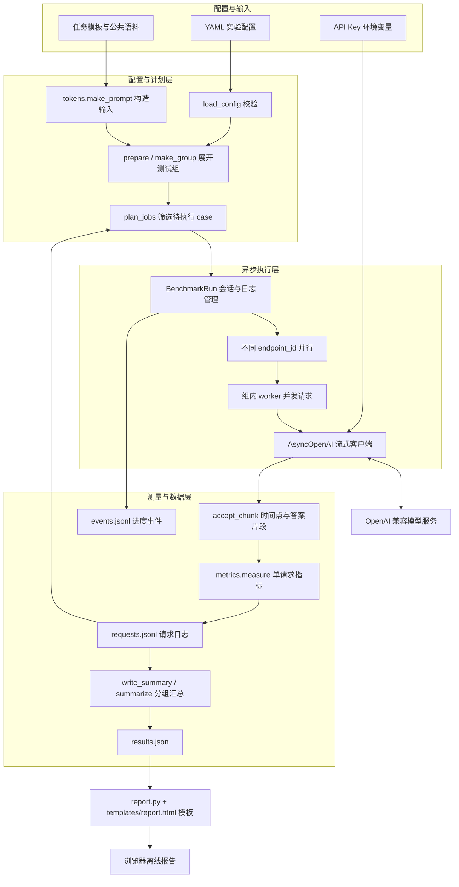
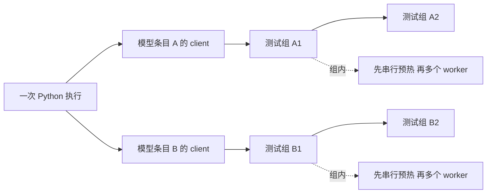
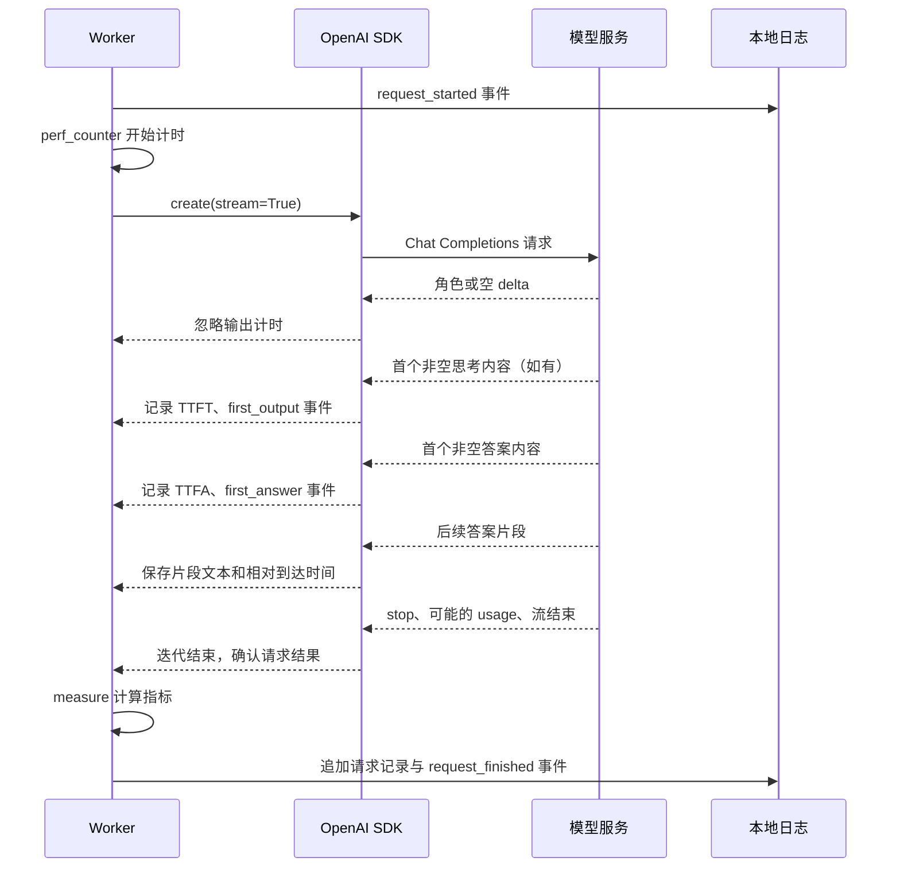
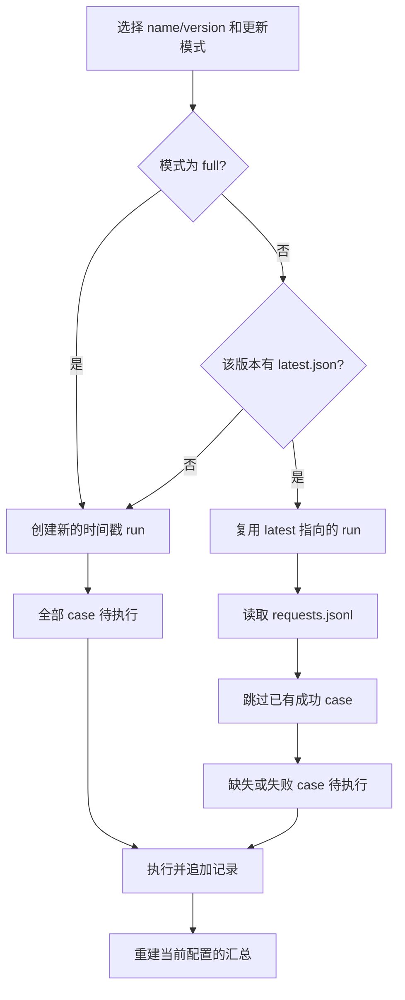

# LLM API 性能评测（performance-v2）

## OSS 结果存储（2026-10-23）

线上评测结果使用北京地域的私有桶 `llm-performance-eval`，对象前缀为 `results/`。结果列表、JSON/JSONL、HTML 报告和增量续跑读取 OSS；任务历史也从 OSS 恢复。原有本地测试记录已清空。

`RESULTS_BACKEND=oss` 时，本地 `results/` 只作为工作目录与失败重试队列：执行中每 5 秒尝试上传检查点，结束/停止后上传全部结果与报告，最后提交任务元数据；全部成功后删除该运行的本地文件。上传失败时显示「结果上传中」及错误提示，每 15 秒重试，重启也会重试。OSS 不可用时查询返回 503，不回退到旧本地文件。异常断电且本地磁盘丢失时，尚未上传的检查点仍可能丢失。

配置与凭证保存在被 Git 忽略、权限 `0600` 的 `state/oss.env`，部署时注入容器，浏览器不接触 OSS 密钥。使用官方 [OSS Python SDK V2](https://github.com/aliyun/alibabacloud-oss-python-sdk-v2)。没有配置存储后端的开发环境仍使用本地存储；下文目录结构与文件字段适用于两种后端，部署配置见 [DEPLOYMENT.md](DEPLOYMENT.md)。单 worker 部署仍是前提，OSS 不提供跨进程评测写锁。


## 网页评测工作流（2026-10-23）

工作台按「连接源 → 评测对象 → 统一评测条件 → 开始评测」组织。顶部按实验配置、评测任务、结果分析分区；连接源列表与当前来源编辑器并列，模型选择区可切换来源，已选模型统一显示来源和独立推理档位。右侧显示本次组合及预计请求数，不再需要手动检查计划。

- 每个连接源独立保存 `id / name / mode / base_url`。默认源使用服务端 SG 的 `DASHSCOPE_API_KEY` / `DASHSCOPE_BASE_URL`，兼容 `MODELSTUDIO_API_KEY_SG` / `MODELSTUDIO_HOST_SG`；自定义源使用独立 OpenAI 兼容地址和 Key。服务端默认 Key 不会转发到自定义地址。
- 同一模型可以分别从多个来源加入。例如「来源 A / model-x」和「来源 B / model-x」是两个独立评测对象；切换来源只切换编辑器和模型目录，不重新绑定其他来源的模型。删除来源会移除该来源下的已选模型。
- 自定义 Key 输入后自动保存到当前浏览器的 localStorage，按连接源 ID 和规范化 API 地址绑定，刷新后恢复。切换其他来源、地址、路径或协议不会误带旧 Key；可用「清除本机 Key」清除此来源在本机保存的全部 Key，同浏览器的其他标签页同步清除。删除来源也清除其本机 Key。Key 只随目录查询和运行请求发送，不写入服务器共享配置或报告。不同浏览器的存储相互隔离；同一浏览器配置的共用者及同源页面脚本仍可读取本机存储，这不是账号级隔离。浏览器禁止存储时，明确提示仅在当前页面有效。连接源元数据、评测条件及运行模式也自动保存到本机 `llm-performance.workspace.v1`，默认没有失效时间，刷新优先恢复本机工作区。升级时若旧缓存只留有 Key，会从唯一的地址绑定恢复缺失连接源；仅首次使用从服务器配置初始化；不再依赖手动保存。清除站点数据或更换浏览器会失去本机配置。
- v3 配置保存连接源、模型来源引用和每个模型的推理档位；已有 v2 网页配置自动迁移为来源列表。网页自动保存不改写服务器共享配置，`PUT /api/config` 仍供程序调用。历史结果仍可查看，缺少来源标签的旧报告使用端点域名显示来源。
- Base URL 输入框识别误填的 `/chat/completions`、`/models` 等具体接口路径，显示基础地址建议，可点击应用；保留代理路径前缀，不自动改址、转移 Key 或重新请求。目录 404 会说明实际请求地址，并区分可建议地址与来源可能不提供模型列表的情况；旧缓存仍显示具体失败原因。
- 每次打开或刷新页面均清空模型选择（含旧缓存中的选择），不影响后台任务；搜索、勾选当前来源 `/models` 列表，或手动填写 Model Name。每个来源独立维护当前页面的目录状态；切换或修改来源后，迟到的请求不会覆盖当前列表。
- 每个模型的推理强度可多选，默认沿用服务端设置；low / medium / high 等档位分别生成评测组合。展开「自定义请求参数」可按档位编辑 JSON，参数独立保存，不按模型名称推断支持能力。
- 输入 Token 档位使用多选下拉列表，支持同时勾选 512 / 1024 / 2048，并可叠加逗号分隔的自定义档位；重复值自动去重，空选择或无效自定义值会阻止启动。统一设置并发数和请求次数；实验名称、版本、预热、超时、缓存标签及增量/全量模式收在高级设置。暂未实现的视觉评测入口已移除。
- 「开始评测」直接提交配置快照。服务端先校验配置、检查各来源 Key、计算增量任务并检查运行锁，全部通过后才启动请求。配置错误直接显示，不启动部分来源。提交期间锁定编辑和重复点击。右侧显示完整组合的预计数量和每项重试上限。提交成功后转到任务页，配置立即解锁，可继续启动独立任务。网页默认新建运行；增量模式不能同时写入同一运行目录。
- 每个后台任务独立显示进度条、成功/失败/请求中/等待重试及累计重试数，单独停止。完成数按评测项计算，重试不增加分母；失败项耗尽重试预算才计入完成。日志保留为调试与导出文件，不在主界面滚动展示。
- `max_retries` 可设置 0–5，网页默认 2，旧 CLI 配置未声明时为 0。仅自动重试 429、408、5xx、超时、网络失败及断流，按 1、2、4、8、16 秒退避；不重试鉴权、参数、输出截断或取消。每次尝试独立记录，预热不自动重试，单次请求指标不包含退避耗时。
- 刷新页面或关闭浏览器不停止后台任务。线上任务元数据持久化到 OSS 的 `results/.jobs/`，本地仅暂存待上传记录；服务重启后从 OSS 恢复，将未完成任务标记中断。服务端不保存自定义 Key，因此不自动重新发起请求，可使用增量模式补跑。
- 主题沿用原有简洁布局，采用白色页面、浅灰卡片底色和 1px 浅灰外框、深色按钮及无衬线标题；输入框保持白底浅色细边框，任务与报告卡片通过底色区分层级。
- 结果表、模型选择器和图例明确显示来源；支持按来源、模型、任务、输入 Token 和并发筛选。CSV、JSON 与新生成的离线 HTML 均保留来源信息。同名模型不会合并统计，也不会跨来源复用成功记录；改名不改变测试组身份，地址、Key 或请求条件改变会重新评测。

Web API：`GET /api/jobs` 列出独立任务和进度，`POST /api/jobs/{job_id}/stop` 停止指定任务；旧 `/api/status` 和 `/api/stop` 仅指向最近启动的任务。`POST /api/models` 仍接受单个 `connection`（目录查询使用当前来源）。`POST /api/plan`、`POST /api/runs` 和 `PUT /api/config` 接受 `config.providers`、模型上的 `provider_id`，以及与 `config` 并列的 `connections: [{id, api_key}]`。连接元数据由配置中的来源解析，Key 单独传递。`GET /api/config` 只返回非敏感配置及默认连接状态。旧的单 `connection` API 和命令行环境变量端点继续兼容；`/api/plan` 保留供程序预检，网页不再要求点击此步骤。

> 本仓库按本文方案从零实现，代码位于当前仓库根目录。新增 Model Studio 风格 Web 工作台，部署端口为 **8001**。部署、模型目录及 CLI 操作见 [DEPLOYMENT.md](DEPLOYMENT.md)。本文保留设计背景；命令行默认只检查计划，并新增命令行参数、免登录工作台、完整端点模型目录及原子 JSON 写入。下文模型与 profile 是需求快照；CLI 重点示例为 `config.focus.example.yaml`；新版网页首次从接口选模，工作流以本文开头说明为准。端点模型目录已在线获取，具体请求参数仍需实测验证。

`performance-v2` 是一个配置驱动的大模型 API 性能评测工具。它把任务、模型端点、思考配置、输入 Token 档位、并发档位和重复次数展开成实验矩阵，通过 OpenAI 兼容的 Chat Completions 流式接口发送请求，记录客户端实际观察到的响应时间与答案片段，最终输出可续跑的请求日志、JSON 汇总和离线 HTML 报告。

它主要回答：在相同输入和明确的请求条件下，哪个模型更早开始输出、多久开始给出答案、答案输出有多快、完成需要多久，以及哪些测试项仍未成功。当前内置任务是对服务运行记录提出分析建议，工具本身不评价建议的正确性。

本文以本目录的实际代码和配置为准。示例中的模型名称与 profile 是仓库配置快照，不代表执行器已验证服务端当前的模型可用性或参数支持范围。

## 阅读导航

- [1. 项目背景与设计目标](#1-项目背景与设计目标)
- [2. 技术架构与代码组织](#2-技术架构与代码组织)
- [3. 核心概念与实验矩阵](#3-核心概念与实验矩阵)
- [4. 从配置到报告的完整流程](#4-从配置到报告的完整流程)
- [5. 快速开始与运行方式](#5-快速开始与运行方式)
- [6. YAML 配置详解](#6-yaml-配置详解)
- [7. 输入构造与统一 Token 口径](#7-输入构造与统一-token-口径)
- [8. 流式采样与指标定义](#8-流式采样与指标定义)
- [9. 增量续跑版本与实验身份](#9-增量续跑版本与实验身份)
- [10. 结果文件与数据字典](#10-结果文件与数据字典)
- [11. HTML 报告与结果解读](#11-html-报告与结果解读)
- [12. 错误分类与排查](#12-错误分类与排查)
- [13. 测试与验证范围](#13-测试与验证范围)
- [14. 扩展方式与已知边界](#14-扩展方式与已知边界)

## 1. 项目背景与设计目标

### 1.1 为什么需要统一评测

接入多个大模型时，只比较一次请求的总耗时，很难区分模型能力、思考时间、答案长度、服务端限流和本地网络的影响。具体有几个问题：

| 比较中常见的问题 | 本项目的处理方式 | 仍需注意的条件 |
| --- | --- | --- |
| 不同模型使用不同 tokenizer，原生 Token 数不能直接当成同一把尺子 | 对完整用户提示词和答案统一使用 `o200k_base` 计数，原生 usage 另存 | 统一文本 Token 不等于模型内部计算量 |
| 思考模型已经开始推理，但用户还没有看到答案 | 分别记录首个生成内容的 TTFT 和首个答案内容的 TTFA | 只能观察接口实际暴露的思考内容 |
| 把 SSE 帧数当 Token 数，或把思考 Token 算入答案速度 | 对拼接后的答案重新编码，单独计算可见答案速度 | 流式片段大小会影响速度估计 |
| 并发不同、输入不同的样本被混成一组 | 将端点、参数、输入指纹、并发等写入稳定的测试组身份 | 补跑时实际在途请求数可能低于配置档位 |
| 一次运行中断后只能从头重测 | 用追加式请求日志跳过已有成功项，只补缺失或失败项 | 补跑可能跨时段，需要结合会话分析 |
| 补跑成功后删除失败记录，无法回溯问题 | 保留所有请求尝试，汇总当前配置选中的测试项 | 最终测试项成功率不代表单次请求可靠性 |
| 查看结果需要重新请求模型 | 报告生成独立于执行器，只读取已有 JSON | HTML 是生成时的快照，不实时刷新 |

### 1.2 与上一版的关系

需求来源中的 `performance/` 目录保留了上一版脚本；当前仓库不包含上一版。本文的 `performance-v2/` 在此仓库直接对应根目录，是一个独立的 Python 子项目，有自己的依赖文件、输入构造、日志和报告流程。两版的结果口径存在差异，不能直接拼接后排名。

| 方面 | `performance/` 上一版 | `performance-v2/` 当前实现 |
| --- | --- | --- |
| 实验配置 | JSON 模型清单和脚本顶部参数 | YAML 统一描述任务与矩阵，脚本顶部选择运行方式 |
| 输入规模 | 按字符数构造 | 按公共 tokenizer 精确构造完整用户提示词 |
| 答案速度 | 依赖服务端 Token 用量 | 基于答案文本与片段到达时间，不依赖 usage |
| 并发身份 | 可在同一逻辑项中出现不同并发工况 | 配置并发档位参与 `group_id` |
| 失败保留 | 存在成功后清理旧失败的逻辑 | 追加保留失败、取消和后续成功尝试 |
| 结果组织 | 以运行名称组织 | `name / version / run` 分层，并记录启动会话 |
| E2E | 计到流结束 | 成功确认后取最后生成内容时间，另存流关闭时间 |
| 报告 | 以 JSON 结果为主 | 独立生成单文件 HTML，支持筛选与排序 |

### 1.3 适用场景与范围

适合模型接入验证、同任务下的模型与思考 profile 对比、不同输入长度和并发档位的观察，以及调整参数或版本后的性能回归。

当前实现是单机、有限批次、客户端视角的文本流式评测。它不实现回答质量评分、价格或费用计算、固定 RPS 压测、持续流量、分布式调度、服务端内部耗时拆分，也不测多模态、工具调用或 Responses API。配置更大的并发值不会自动得到服务最大容量。

## 2. 技术架构与代码组织

### 2.1 总体架构

系统分为配置与计划、异步执行、测量与持久化、离线展示四部分。运行时只有 Python 进程向模型服务发起请求；查看离线报告不需要启动后端。另提供 `server.py` 管理实验和报告，监听 8001 端口。



### 2.2 技术栈

| 技术 | 本项目中的作用 |
| --- | --- |
| Python `>=3.12` | 主执行环境；`.python-version` 指定 `3.12` |
| `uv`、`uv.lock` | 管理本目录独立环境与锁定依赖 |
| `asyncio.TaskGroup` | 管理模型之间、单个测试组内的并发与取消传播 |
| `asyncio.timeout` | 对一次请求从创建到流结束设置总时间限制 |
| OpenAI Python SDK `>=2,<3` | 使用 `AsyncOpenAI.chat.completions.create()` 调用兼容接口 |
| PyYAML `>=6,<7` | 加载 YAML 配置 |
| tiktoken `>=0.7,<1` | 用 `o200k_base` 构造输入并统计统一 Token |
| JSON / JSONL | 保存配置快照、逐请求历史、进度事件和汇总 |
| 原生 HTML / CSS / JavaScript | 渲染离线报告，无前端构建步骤或外部脚本依赖 |
| `unittest`、`httpx.MockTransport` | 模拟流响应并验证 SDK 解析与执行管线 |

依赖范围由 `pyproject.toml` 声明，依赖已锁定于 `uv.lock`；Docker 使用从同一锁文件导出的 `requirements.lock`。每次执行还会记录实际使用的 Python、操作系统、OpenAI SDK 与 tiktoken 版本。

### 2.3 目录与职责

```text
performance-v2/
├── README.md                    # 架构、用法和统计口径
├── pyproject.toml               # 独立子项目依赖
├── uv.lock                      # 锁定依赖
├── .python-version              # Python 版本选择
├── config.example.yaml          # 当前冒烟配置
├── config.matrix.example.yaml   # 当前较完整的模型矩阵
├── benchmark.py                 # 计划、请求、调度、续跑、日志与汇总
├── tokens.py                    # 统一计数器与精确输入构造
├── metrics.py                   # 单请求指标与分组统计
├── report.py                    # 读取结果、注入 HTML 模板
├── report.html                  # 可直接打开的参考报告
├── templates/report.html        # 报告模板，含 __RESULT_DATA__ 占位符
├── prompts/
│   ├── summary.txt              # 任务指令，含一个 {{context}}
│   └── corpus.txt               # 公共服务运行记录语料
├── tests/
│   └── test_benchmark.py        # 本地模拟测试
├── server.py                    # Web 控制接口与后台运行管理
├── static/                      # Model Studio 风格工作台
├── Dockerfile / compose.yaml    # 8001 端口部署
├── deploy/                      # 启动脚本与 systemd 模板
└── results/                     # 自动生成，已在 .gitignore 中忽略
```

根目录的 `report.html` 是可直接打开的参考报告；`templates/report.html` 是生成模板。运行结果目录中的 `report.html` 对应该次评测的实际数据。

### 2.4 主要函数与边界

| 模块 / 函数 | 输入 | 输出或副作用 |
| --- | --- | --- |
| `tokens.make_prompt()` | 任务、目标 Token 数、配置目录 | 可供所有模型复用的用户提示词 |
| `load_config()` | YAML 路径 | 经过基本校验的配置字典 |
| `prepare()` / `make_group()` | 配置、提示词 | `(model, prompt, group)` 列表及稳定组标识 |
| `resolve_output()` | 名称、版本、更新模式 | run 目录与实际生效模式 |
| `read_records()` / `plan_jobs()` | 请求历史、当前测试组 | 各组仍需执行的 repetition 序号 |
| `request()` / `accept_chunk()` | SDK client、请求参数、流式 chunk | 原始时间点、答案片段、usage 与状态 |
| `BenchmarkRun.run_model()` / `run_group()` | 分模型任务、待跑序号 | 复用 client，控制串行和并发边界 |
| `BenchmarkRun.save()` | 单请求原始记录 | 调用 `measure()`，追加日志并刷新缓冲区 |
| `metrics.totals()` / `summarize()` | 请求记录、计划数 | 测试项计数、错误计数、指标分布 |
| `BenchmarkRun.write_summary()` | 全部历史与当前计划 | 重写本 run 的 `results.json` |
| `report.build_report()` | `results.json`、输出路径 | 写入内嵌汇总数据的 HTML |

## 3. 核心概念与实验矩阵

### 3.1 名称、版本、运行与会话

| 概念 | 含义 | 示例 |
| --- | --- | --- |
| `name` | 实验名称，也是结果目录的第一层 | `llm-performance-smoke` |
| `version` | 用户指定的实验版本，用于隔离一套结果 | `v1` |
| `run_id` | 一次全量实验的目录名，增量执行复用该目录 | `20260907-103000-123456` |
| `session_id` | 每次进入实际执行流程生成的启动会话标识 | UTC 时间戳字符串 |
| `endpoint_id` | YAML 中模型条目的 `id`，也是跨模型调度分桶键 | `qwen3.8-max` |
| `profile` | 该模型的一套思考与请求参数配置 | `off`、`low` |
| `group_id` | 一组固定实验条件的稳定指纹 | 16 位十六进制字符串 |
| `case_id` | 一个组内的某个正式 repetition | `<group_id>-0001` |
| `attempt` | 该 case 已写入的尝试序号 | 首次为 `1`，后续补跑递增 |
| `phase` | 请求用途 | `measured` 正式请求、`warmup` 预热 |

一个 run 可以包含多次 session；一个 group 包含多个 case；一个 case 可以有多次失败或取消尝试，成功后在下次增量中跳过。

### 3.2 矩阵展开与调用量

每个测试组对应：

```text
任务 × 启用模型条目 × 该模型的 profile × 输入 Token 档位 × 并发档位
```

设任务数为 T，输入档位数为 I，并发档位数为 C，所有启用模型的 profile 总数为 P，每组正式次数为 R，预热次数为 W：

```text
测试组数 G = T × I × C × P
全量正式请求数 = G × R
全量预热请求数 = G × W
全量总调用数 = G × (R + W)

增量正式请求数 = 当前仍未成功的 case 数
增量预热请求数 = 有待执行 case 的组数 × W
```

这是假设本次执行能走完计划的调用数量，不包含后续重新启动的补跑，也不是费用估算。

### 3.3 当前两份配置的实际规模

以下统计对应当前仓库文件内容。配置调整后，以 `benchmark.py` 打印的计划为准。

| 配置 | 启用模型数 | 启用 profile 总数 | 输入档位 | 并发档位 | 正式次数 / 预热次数 | 全量组数 | 全量调用数 |
| --- | ---: | ---: | --- | --- | --- | ---: | --- |
| `config.example.yaml` | 3 | 12 | 512、1024 | `[10]` | 3 / 0 | 24 | 72 正式 + 0 预热 |
| `config.matrix.example.yaml` | 6 | 26 | 512、1024 | `[5]` | 5 / 1 | 52 | 260 正式 + 52 预热 = 312 |

两份配置都只启用了一个 `summary` 任务。文件名中的 `matrix` 不表示自动覆盖全部输入长度；当前同样只有两个输入档位。

| 模型 ID | 仓库中声明的 profile | 冒烟配置 | 矩阵配置 |
| --- | --- | --- | --- |
| `qwen3.8-max` | `off`、`low`、`medium`、`xhigh` | 启用 | 启用 |
| `qwen3.8-flash` | `off`、`low`、`medium`、`xhigh` | 启用 | 启用 |
| `deepseek-v4-pro-0813` | `off`、`low`、`high`、`max` | 启用 | 启用 |
| `deepseek-v4-flash-0731` | `off`、`low`、`high`、`max` | 禁用 | 启用 |
| `glm-5.2` | `off`、`minimal`、`low`、`medium`、`high`、`xhigh`、`max` | 禁用 | 启用 |
| `kimi-k3` | `low`、`high`、`max` | 禁用 | 启用 |
| `MiniMax/MiniMax-M3` | `off`、`adaptive` | 禁用 | 禁用 |

执行器只运行配置中已有且启用的组合，不自动推断哪些模型支持关闭思考，也不为模型补充默认 profile。

## 4. 从配置到报告的完整流程

### 4.1 启动与计划生成

1. `main()` 读取 `CONFIG_PATH`，检查版本名、重复次数、预热数、并发列表和超时。
2. 根据 `name`、`version`、`OUTPUT_ROOT` 和 `UPDATE_MODE` 选择结果目录。
3. 为每个任务与输入档位构造一次提示词，再复用于不同模型和 profile。
4. 合并参数、生成测试组指纹，拒绝重复测试组合。
5. 读取目标 run 的 `requests.jsonl`，找出已有成功记录的正式 case。
6. 生成各组待执行序号，打印总组数、计划项数、待跑调用数、预热数、输出位置和生效模式。
7. `EXECUTE=False` 时到此结束；不创建执行日志、不检查 API Key、不请求模型。首次使用 tiktoken 时仍可能需要下载编码表。

### 4.2 实际执行

1. 创建 run 目录，以独占创建方式写入 `.run.lock`，内容为当前进程 PID。
2. 再次读取历史并生成本轮任务，检查有待跑项的模型是否具备密钥环境变量。
3. 生成 `session_id` 与环境快照，更新该版本的 `latest.json`。
4. 打开 `events.jsonl` 与 `requests.jsonl`，均使用追加模式。
5. 按模型条目的 `id` 分桶，通过外层 `TaskGroup` 同时执行不同桶。
6. 每个模型桶创建一个 `AsyncOpenAI` client，复用它依次执行该模型的各组。
7. 对有待跑项的组，先串行执行预热，再启动有限数量的 worker 领取正式 case。
8. 每次请求结束、失败或被取消后，计算指标，追加请求记录，刷新文件缓冲区并输出进度。
9. 执行流程退出时，在 `finally` 中根据历史生成 `results.json`；正常退出或可处理的取消会走此路径。
10. 外层清理 `.run.lock`。报告需另行运行 `report.py` 生成。

### 4.3 并发调度到底如何工作



`concurrencies: [20]` 表示当前组最多允许 20 个 worker 同时发起请求，不表示每秒 20 个请求，也不是启动 20 个 Python 进程。worker 完成一个请求后，马上领取下一个序号，没有固定发包间隔。

实际 worker 数为 `min(配置并发档位, 当前组待执行 case 数)`。例如 `repetitions=100`、并发 20 时，共做 100 次正式请求；如果增量只剩 3 项，则只创建 3 个 worker，结果中的 `concurrency` 仍为 20。

同一个模型条目的组是串行的，具体遍历顺序为：任务 → 输入档位 → 并发档位 → profile，profile 是最内层。不同模型进度独立，不在每个输入档位之间设置全局同步屏障。

整个进程的在途请求上限，约为各个正在执行模型组的 worker 上限之和。当前冒烟配置每模型每组只有 3 次正式请求，所以理论峰值是 `3 模型 × 3 = 9`，并非 `3 × 10 = 30`。矩阵配置的理论正式请求峰值是 `6 × 5 = 30`；实际峰值取决于各组执行是否重叠。

模型条目 `id` 应唯一。即使两个条目指向同一个真实模型，只要 `id` 不同，就可能并行运行并共同占用同一服务端配额。执行器没有全局信号量、RPM/TPM 限速或自动退避。

### 4.4 一次流式请求的时序



如果没有可见思考内容，首个答案同时确定 TTFT 和 TTFA。SDK 隐式重试固定为 `max_retries=0`；执行器使用配置中的 `max_retries` 显式重试临时失败，记录每次尝试。预算耗尽后可下次增量启动继续补跑。

## 5. 快速开始与运行方式

### 5.1 准备独立环境

先进入本目录，再同步环境，避免误用仓库根目录的另一个 Python 项目：

```bash
cd /home/pillar/llm-performance
uv sync --locked
```

已有 `.venv` 不代表依赖与锁文件一致，仍以同步结果为准。CLI 与离线报告不需要数据库或 Web 服务；如使用工作台，见 [部署说明](DEPLOYMENT.md)。

### 5.2 准备自己的配置和密钥

可复制一份本地配置，保留仓库示例供对照：

```bash
cp config.example.yaml config.local.yaml
export DASHSCOPE_API_KEY='替换为你的实际 API Key'
```

`config.local.*` 已被本目录 `.gitignore` 忽略。密钥由程序从环境变量读取；当前代码没有自动加载 `.env` 文件。使用编辑器运行时，也需要为对应运行配置设置环境变量。

仓库 YAML 中写有具体 Workspace 地址，并非通用占位地址。应将 `base_url`、`model` 和 `api_key_env` 改为自己有权限访问且相互匹配的服务配置。只有启用并仍有待跑项的模型需要 Key；禁用的 MiniMax 条目不要求设置北京地域 Key。

### 5.3 先查看计划

在 `benchmark.py` 顶部设置：

```python
CONFIG_PATH = Path(__file__).with_name('config.local.yaml')
UPDATE_MODE = 'incremental'
EXECUTE = False
OUTPUT_ROOT = None
```

**当前实现默认 `EXECUTE = False`，只检查计划；传 `--execute` 后才会请求模型。**

```bash
uv run python benchmark.py
```

输出计划包含：

| 字段 | 如何理解 |
| --- | --- |
| `groups` | 当前配置展开的总测试组数 |
| `planned_cases` | 当前配置的正式逻辑项总数 |
| `pending_calls` | 本轮要执行的正式请求数 |
| `warmup_calls` | 本轮有待跑项的组所需预热数 |
| `concurrencies` | 配置的并发档位，并非实测峰值 |
| `output` | 本次会使用的 run 目录 |
| `configured_update_mode` | 顶部配置的模式 |
| `effective_update_mode` | 查找历史后实际生效的模式 |
| `version` / `execute` | 当前版本与是否执行请求 |

计划模式为新 run 计算的时间戳不会预留；之后正式启动时，可能生成另一个时间戳目录。

### 5.4 执行与续跑

检查计划后，将 `EXECUTE` 改为 `True`，再次运行相同命令。希望补缺失或失败项时保留 `UPDATE_MODE='incremental'`；希望独立重测所有项时使用 `'full'`。

| 顶部变量 | 含义 |
| --- | --- |
| `CONFIG_PATH` | `Path` 对象，指向 YAML 配置 |
| `UPDATE_MODE` | `'incremental'` 或 `'full'` |
| `EXECUTE` | `False` 仅计划，`True` 执行 |
| `OUTPUT_ROOT` | `None` 时使用配置文件所在目录下的 `results/`；自定义时传 `Path` |

例如自定义结果根目录：

```python
OUTPUT_ROOT = Path('/你的结果目录/llm-benchmark')
```

这些脚本变量仍可使用；当前实现另外支持 `--config`、`--execute`、`--mode` 和 `--output-root`。Web 工作台也支持模型与 profile 选择，CLI 选择子集则修改 YAML。

### 5.5 生成报告

在 `report.py` 顶部选择与评测相同的配置和结果根目录：

```python
CONFIG_PATH = Path(__file__).with_name('config.local.yaml')
OUTPUT_ROOT = None
RESULTS_PATH = None
```

然后执行：

```bash
uv run python report.py
```

程序读取该 `name/version` 的 `latest.json`，在对应 `results.json` 同目录生成 `report.html`，可直接用浏览器打开。若 benchmark 使用矩阵配置，report 也需要选择矩阵配置，否则默认仍定位冒烟实验。

查看某个历史 run 时，直接指定：

```python
RESULTS_PATH = Path('/完整路径/results/实验名称/v1/runs/某次运行/results.json')
```

`RESULTS_PATH` 非空时优先使用该结果，不再按配置寻找 latest。重新生成会覆盖该 run 的旧 HTML，但不发出模型请求。

## 6. YAML 配置详解

### 6.1 最小单模型示例

以下是结构示例，地址、模型名称及参数需要按自己的服务修改：

```yaml
name: llm-performance-local
version: v1
repetitions: 3
warmup: 0
concurrencies: [1]
input_tokens: [512]
timeout_seconds: 300
cache_state: uncontrolled
parameters: {}

tasks:
  - id: summary
    template_file: prompts/summary.txt
    corpus_file: prompts/corpus.txt

models:
  - id: endpoint-a
    model: your-model-id
    base_url: https://your-service.example/compatible-mode/v1
    api_key_env: DASHSCOPE_API_KEY
    enabled: true
    include_usage: true
    profiles:
      - name: 'off'
        thinking_enabled: false
        parameters:
          enable_thinking: false
```

如果服务不接受 `enable_thinking`，应使用该服务支持的参数或 `{}`，不能只改模型名后假设所有字段通用。YAML 的 `off` 等名字建议加引号，避免被 YAML 解析为布尔值。

### 6.2 根字段

| 字段 | 必填 / 默认 | 说明 |
| --- | --- | --- |
| `name` | 必填 | 实验目录名；建议使用普通目录名称，避免路径分隔符 |
| `version` | 必填 | 转为字符串后不能为空，不能是 `.`、`..` 或包含斜杠 |
| `repetitions` | 必填 | 每组正式请求次数，应为正整数 |
| `warmup` | 必填 | 每个有待跑项的组的预热次数，应为非负整数 |
| `concurrencies` | 必填 | 非空正整数列表，每个值生成独立测试组 |
| `input_tokens` | 必填 | 输入档位列表，元素为目标整数或 `null` |
| `timeout_seconds` | 必填 | 正数，单请求总超时，同时传给 SDK |
| `cache_state` | 必填 | 实验缓存条件标签，参与组身份，不控制缓存 |
| `parameters` | 可选，`{}` | 全局请求 body 参数 |
| `tasks` | 必填 | 至少需要能生成测试组的任务列表 |
| `models` | 必填 | 模型条目列表，至少需要一个启用且含 profile 的条目 |
| `data_source` | 可选，`live_api` | 输出数据来源标签；`synthetic_fixture` 使报告标为模拟示例 |

`data_source` 只是标签。设置 `synthetic_fixture` 不会把真实请求变成模拟请求；测试通过替换 SDK client 才实现无外部模型调用。

当前配置校验仅覆盖部分边界，不是完整 schema 校验。比如次数应写整数，模型 `id` 应唯一，路径应有效；不符合这些要求可能在后续构造或执行时才报错。

### 6.3 任务字段

| 字段 | 说明 |
| --- | --- |
| `id` | 任务标识，参与测试组身份 |
| `template_file` | UTF-8 任务模板文件，必须恰好包含一个 `{{context}}` |
| `corpus_file` | UTF-8 公共语料文件 |

模板和语料的相对路径均相对于 **YAML 文件所在目录** 解析。把配置复制到其他目录时，要同时调整这两个路径。

### 6.4 模型与 profile 字段

| 字段 | 必填 / 默认 | 说明 |
| --- | --- | --- |
| 模型 `id` | 必填 | 端点条目标识，影响调度分桶和组身份 |
| `model` | 必填 | 发送到 API 的实际模型 ID |
| `base_url` | 必填 | 兼容 API 根地址，client 会统一末尾斜杠 |
| `api_key_env` | 必填 | API Key 环境变量名，名称写入结果，变量值不主动写入 |
| `enabled` | 可选，`true` | 是否展开此模型 |
| `include_usage` | 可选，`true` | 是否发送 `stream_options.include_usage=true` |
| 模型 `parameters` | 可选，`{}` | 覆盖全局同名参数 |
| `profiles` | 必填 | 该模型要测试的 profile 列表 |
| profile `name` | 必填 | 配置名称，参与组身份并显示于报告 |
| `thinking_enabled` | 必填 | 结果元信息，取 true / false / null（未知），也用于未知 reasoning Token 的解释；本身不发送给服务端 |
| profile `parameters` | 必填，可为 `{}` | 覆盖模型、全局同名参数，决定真实请求内容 |

### 6.5 参数合并与实际请求

参数按“全局 → 模型 → profile”顺序浅合并，后者覆盖前者。嵌套对象会整体替换，不逐层合并。例如 profile 提供 `thinking: {type: adaptive}` 时，会替换模型级完整的 `thinking` 对象。

执行器形成的 SDK 调用结构为：

```python
await client.chat.completions.create(
    model=model['model'],
    messages=[{'role': 'user', 'content': prompt}],
    stream=True,
    extra_body=merged_parameters,
    stream_options={'include_usage': True},  # include_usage=True 时才加入
)
```

`parameters` 中标准字段与厂商扩展字段都通过 SDK 的 `extra_body` 透传到请求 JSON body。因此 YAML 应直接写 `temperature`、`reasoning_effort`、`enable_thinking` 等字段，不需要再套一层 `extra_body`。

`model`、`messages`、`stream`、`stream_options`、`n` 是保留字段，不允许放在 `parameters` 中覆盖。当前始终发送一条 `user` 消息，只解析第一个 choice。

示例没有统一设置采样温度或最大输出 Token，实际输出长度由提示词和服务端默认值共同决定。需要固定时，可在 `parameters` 中显式配置服务支持的 `temperature`、`max_tokens` 或其他输出限制；截断结果会判为失败。

### 6.6 思考开关与预热

`thinking_enabled: true` 不等价于发送 `enable_thinking: true`。若模型始终思考且不需要控制参数，可以配置：

```yaml
profiles:
  - name: 'on'
    thinking_enabled: true
    parameters: {}
```

是否出现思考内容通过 `reasoning_observed` 记录，但执行器不会因观察结果与标签不同而自动判失败。读取思考文本只支持当前实现识别的 `reasoning_content` 字段；其他协议字段需要扩展解析。

预热使用同组的提示词、参数和 client，逐次串行执行。预热结果写入日志与 `warmups`，不参与正式成功率及指标分位数；某次预热失败不会自动阻止后续正式请求。全组都已成功时，增量执行不会再预热。预热可能影响缓存与连接状态，`warmup` 本身也参与组身份。

## 7. 输入构造与统一 Token 口径

### 7.1 测的是完整用户文本

`input_tokens: [512, 1024]` 指整条用户提示词，包括任务指令、材料和填充文本，在 `o200k_base` 下分别精确为 512 和 1024 Token。`1K=1024` 是这里使用的档位约定。

计数不包含 Chat Completions 的消息包装、服务端隐含提示词或特殊协议开销，所以原生 `usage.prompt_tokens` 不要求等于输入档位。不同模型收到同一文本，统一计数一致，但原生输入用量可以不同。

### 7.2 `make_prompt()` 的构造算法

1. 读取模板与语料，确认模板中恰好有一个 `{{context}}`。
2. 计算去掉材料后的模板 Token 数，再额外预留 8 Token 的边界空间。
3. 根据目标长度确定性重复 `corpus + '\n'`，使材料足够长。
4. 将材料编码为 Token，按剩余预算截取，再解码；忽略被截断的不完整 UTF-8 字符。
5. 在材料末尾使用换行和重复的 `' x'` 填充小量差额，避免截断任务指令。
6. 对最终完整提示词重新编码，必须恰好达到目标，否则报错。
7. 为组记录 `benchmark_input_tokens` 与 UTF-8 文本的 `prompt_sha256`。

这是固定模板下的确定性长度构造，不是自动检索或生成新的长文内容。长输入主要由同一公共语料重复而来，因此不能据此推断真实长文理解质量；重复文本也可能触发服务端缓存行为。

同一个 task/input 只构造一次，随后跨模型复用。当前不会把最终提示词全文写入结果；要完整复现实验，需保留当时的 YAML、模板、语料、依赖与代码版本，不能仅依靠 `prompt_sha256` 还原文本。

### 7.3 不分档输入

```yaml
input_tokens: [null]
```

此时直接把原始语料替换进模板，不截取、不补齐。`target_input_tokens` 为 `null`，`benchmark_input_tokens` 仍记录实际公共 Token 数，报告显示“未分档”。

## 8. 流式采样与指标定义

### 8.1 计时边界

时间差使用 `time.perf_counter()` 单调时钟，记录值是 SDK 将 chunk 交付给调用方时的客户端观测值。UTC 墙上时间用于日志关联，不参与延迟计算。

计时起点位于真正调用 `create()` 之前。矩阵构造、等待 worker 领取任务、前置预热均不计入单请求耗时；SDK 内连接池等待、网络、服务端排队与处理、返回传输都会影响观测值。本工具无法把这些时间进一步拆开。

角色帧、空 delta、没有内容的结束帧、usage-only 帧不更新输出时间；非空 `reasoning_content` 或 `content` 才算生成内容。这里的非空按字符串真值判断，纯空白文本也会被视为内容。

### 8.2 时间轴示例

假设一次成功请求的观测为：

```text
0.0 s   发起请求
0.4 s   角色帧                  不算生成内容
0.8 s   首个思考片段            TTFT = 800 ms
2.0 s   首个答案片段            TTFA = 2.0 s
3.0 s   第二个答案片段
4.0 s   最后一个答案片段        E2E = 4.0 s
4.3 s   usage 到达并结束流      stream_close_seconds 约为 4.3 s
```

只有等流迭代结束并通过成功判定后，才为这条请求保留 E2E。E2E 的数值仍取最后生成内容的时间，不包含末尾纯 usage 等待。如果在最后答案后断流，则请求失败，E2E 为 `null`。

代码依赖 SDK 的流迭代正常结束和 `finish_reason`，并不独立检查原始 SSE 是否出现字面量 `[DONE]`，也不会保存原始 SSE 帧。

### 8.3 核心指标

设 `T(text)` 为 `o200k_base` 对文本的 Token 数；答案片段依次为 `a₁ … aₙ`，相对到达时间为 `t₁ … tₙ`。

| 指标 | 字段 / 单位 | 单请求定义 | 汇总 |
| --- | --- | --- | --- |
| 首个生成内容延迟 | `ttft_ms`，毫秒 | 请求开始至首个非空思考或答案内容 | n、mean、P50、P95 |
| 首个答案延迟 | `ttfa_seconds`，秒 | 请求开始至 `a₁` | n、mean、P50、P95 |
| 答案输出速度 | `output_speed_tps`，公共 Token/秒 | `(T(a₁+…+aₙ) - T(a₁)) / (tₙ - t₁)` | n、mean、P50、P5 |
| 生成完成延迟 | `e2e_seconds`，秒 | 成功请求的最后非空思考或答案到达时间 | n、mean、P50、P95 |
| 最大答案间隔 | `max_answer_gap_seconds`，秒 | 所有相邻答案片段到达时间差的最大值 | n、mean、P50、P95 |
| 测试项成功率 | `success_rate`，0～1 | 当前计划中有成功记录的正式 case 数 / 计划 case 数 | 按组与整体计数 |

速度先拼接全文再计数，不能将每个片段的 Token 数简单相加，因为跨片段边界可能改变分词。首片段用于确定计时起点，因此其 Token 数从分子扣除。

以上例为例，若完整答案为 100 Token，首答案片段为 20 Token，则答案速度是 `(100−20)/(4−2)=40 Token/s`。这是可见答案的文本吞吐估计，不是模型内部原生 Token 生成速度，也不包含思考 Token。

只有一个答案片段时，速度与最大答案间隔均为 `null`。时间差或扣除首片段后的 Token 差不为正时，速度也为 `null`；`speed_unavailable_reason` 用于解释原因。`null` 不等于零速度或请求失败。

### 8.4 Token 字段与缺失值

| 字段 | 来源 / 计算方式 |
| --- | --- |
| `benchmark_input_tokens` | 本地对完整用户提示词统一计数 |
| `benchmark_answer_tokens` | 本地对全部答案片段拼接后统一计数；无答案为 `null` |
| `prompt_tokens` | 服务端 `usage.prompt_tokens` |
| `completion_tokens` | 服务端 `usage.completion_tokens` |
| `reasoning_tokens` | `usage.completion_tokens_details.reasoning_tokens`，或满足条件时推定为 0 |
| `answer_tokens` | 原生 `completion_tokens - reasoning_tokens`，两者均已知才计算 |
| `reasoning_observed` | 流中出现思考文本，或 usage 的 reasoning Token 大于 0 |

只有明确配置 `thinking_enabled=false`，并且流中未观察到思考文本，缺失的 `reasoning_tokens` 才按 0 处理。开启思考时缺少 usage 明细，reasoning 和原生 answer Token 保持未知，不用 0 代替。

关闭 `include_usage` 或服务不返回 usage 时，原生 Token 字段可能为空，但公共答案速度仍可根据至少两个答案片段计算。`answer_tokens` 的减法依赖服务端 completion 包含 reasoning 的语义，执行器没有额外做厂商口径转换。

### 8.5 成功判定与分位数

一次请求成功需要同时满足：SDK 流迭代正常结束、存在非空答案片段、`finish_reason='stop'`，并且没有已捕获的请求错误。成功表示接口输出符合这些协议条件，不表示答案内容正确。

分组指标只采用成功请求，且每个指标独立过滤 `null`，所以同一组的 TTFT 样本数和速度样本数可能不同。失败记录仍可能包含部分 TTFT、TTFA 或答案 Token，用于排查，但不进入成功指标分布。

排序后的 n 个有效值，分位位置为 `(n−1)×q`，在相邻值之间线性插值。延迟观察 P95 的高尾部，速度观察 P5 的低尾部；例如 `[1,2,3,4,5]` 的 P5 为 `1.2`。空样本的均值与分位数为 `null`，单个样本的所有分位数相同。

不同测试组不合并计算分位数，也不提供组内 P99。当前示例每组仅 3 或 5 次，主要用于验证流程和初步观察，不能把少量样本插值出的尾部数值理解为稳定的长期表现。

## 9. 增量续跑、版本与实验身份

### 9.1 full 与 incremental



`latest.json` 保存 `run_id`，指向该版本最近进入执行会话的 run；它不是“最近成功完成的 run”指针，目标 run 可以处于 `pending`。每次增量启动也会重写该指针为当前 run。

改变 `name` 或 `version` 会切换目录命名空间。切回已有版本时，增量模式定位该版本的 latest。全量模式始终使用新目录，保留历史 run；它不会删除旧数据，也不会扫描所有历史 run 复用成功项。

### 9.2 group_id 与 case_id 如何生成

`make_group()` 对实验条件字典按键排序序列化为 JSON，做 SHA-256，取前 16 位作为 `group_id`。正式 case 再拼接从 1 开始、至少四位的 repetition 序号。

| 参与 `group_id` 的条件 | 影响 |
| --- | --- |
| `endpoint_id`、`model`、规范化后的 `base_url`、`api_key_env` | 区分模型条目、服务地址与密钥变量名 |
| `profile`、`thinking_enabled`、合并后的 `parameters` | 区分参数与思考实验条件 |
| `task`、`target_input_tokens`、`benchmark_input_tokens`、`prompt_sha256`、`tokenizer` | 区分任务身份和实际输入文本 |
| `concurrency` | 每个并发档形成独立组 |
| `cache_state`、`timeout_seconds`、`warmup`、`include_usage` | 运行条件改变也形成新组 |

`repetitions` 不参与指纹。API Key 的值、机器与网络、代码版本也不参与指纹。`name/version` 通过目录隔离实验，而不是进入组指纹。

因此：

| 修改 | 下次增量行为 |
| --- | --- |
| repetitions 从 20 增至 30 | 同组仅新增 case 0021～0030，并补旧失败项 |
| repetitions 从 30 减至 20 | 当前汇总只选前 20 项，其余历史仍保留 |
| 改变模型/profile 列表顺序 | 相同实验条件保留原 group_id |
| 修改参数、实际提示词、端点、并发、超时或预热数 | 形成新组，原成功项不能替代新组请求 |
| 禁用模型或移除 profile | 从当前计划和汇总移除，历史明细仍在 |
| 同一个密钥变量换了账号 | 组身份不变；需要独立比较时使用 full 或新 version |
| 相同模型别名背后的服务版本变化 | 无法自动识别，需主动重新建立基线 |
| 升级采样或指标实现 | 代码版本不在指纹内，应使用新版本或全量实验 |

### 9.3 失败保留与成功率示例

假设计划有 20 个 case，第一次成功 18 个、失败 2 个，第二次只补 2 个且均成功：

| 统计 | 首次结束 | 补跑成功后 |
| --- | ---: | ---: |
| `planned_cases` | 20 | 20 |
| `attempted_cases` | 20 | 20 |
| `successful_cases` | 18 | 20 |
| `pending_cases` | 2 | 0 |
| `missing_cases` | 0 | 0 |
| `requests` | 20 | 22 |
| `retry_attempts` | 0 | 2 |
| `success_rate` | 90% | 100% |
| 历史失败尝试 | 2 | 2 |

当前 `success_rate` 是最终测试项完成口径，**不是成功请求尝试数 / 全部请求尝试数**。本例尝试级成功比例为 `20/22`，但代码没有单独输出这个比例，也没有预计算“首次成功率”；如需这些指标，应从请求历史按 case 和尝试顺序分析。

`cancelled` 记录保留用于恢复，但从统计请求数、重试次数、失败类型和有效尝试 case 数中排除。其日志 `attempt` 序号仍占一次，所以后续记录的 `attempt` 与统计中的重试次数不必直接对应。

### 9.4 中断与一致性边界

正常 `Ctrl+C` 取消时，已开始的请求会尽量保存为 `cancelled`，未领取的 case 没有请求记录，最终汇总标为 `pending`，下次增量可继续。

`.run.lock` 只保护同一个 run 目录，独立 full run 仍可同时执行并争用服务配额。不同 run 并发更新同一版本的 `latest.json` 没有版本级锁；同一版本需要可预测指针时，应顺序启动。

日志逐条 `flush()`，但没有逐条 `fsync()`；当前实现的 `results.json` 和 `latest.json` 使用同目录临时文件原子替换。强杀或磁盘异常可能留下锁、损坏的 JSON 或不完整 JSONL 行。读取请求日志会严格逐行解析，不会自动跳过坏行。

## 10. 结果文件与数据字典

### 10.1 目录结构与写入时机

```text
results/<name>/<version>/
├── latest.json
└── runs/<run_id>/
    ├── .run.lock          # 执行期间存在，正常清理后消失
    ├── events.jsonl       # 轻量进度事件，实时追加
    ├── requests.jsonl     # 正式与预热请求，完成后逐条追加
    ├── results.json       # 执行退出时生成的汇总与完整历史
    └── report.html        # 单独运行 report.py 生成
```

`requests.jsonl` 是恢复依据。`events.jsonl` 不参与成功项判断，`results.json` 不用于决定跳过哪些请求。执行期间已有 `results.json` 可能还是上一会话快照，网页实时进度读取任务管理器的计数器（`GET /api/jobs`），CLI 可查看控制台或事件日志。

### 10.2 事件日志

每行包含 `event`、`session_id`、UTC `at`，并按事件加入关联字段。

| event | 触发时机 | 主要附加字段 |
| --- | --- | --- |
| `request_started` | 发起 SDK 调用前 | `case_id`、`phase`、`group_id` |
| `first_output` | 首个思考或答案内容到达 | `case_id`、`elapsed_seconds` |
| `first_answer` | 首个答案内容到达 | `case_id`、`elapsed_seconds` |
| `request_finished` | 请求记录完成计算并已追加 | `case_id`、`attempt`、`success`、`error_type` |

事件不是每个 Token 或 chunk 的完整轨迹；答案逐片段时间在请求记录中。没有首输出的失败请求可以只有开始和结束事件。

### 10.3 单请求记录

| 类别 | 主要字段 | 解释 |
| --- | --- | --- |
| 实验身份 | 测试组所有字段、`group_id`、`case_id` | 每条请求自带分组条件 |
| 会话与尝试 | `session_id`、`attempt`、`run_index`、`phase`、`started_at` | `run_index` 是组内 repetition 序号，不是全局完成顺序 |
| 完成状态 | `success`、`error_type`、`finish_reason`、`stream_completed` | 协议结果与分类错误 |
| HTTP 关联 | `status_code`、`request_id` | 优先读取响应 `x-request-id`，否则可能使用 chunk 的 `id` |
| 原始时间点 | `first_output_seconds`、`last_output_seconds`、`stream_close_seconds` | 相对于请求计时起点的秒数 |
| 答案轨迹 | `answer_chunks` | 每项为 `{'at': 相对秒数, 'text': 答案文本}` |
| 原生用量 | `usage` | SDK 返回的 usage 字典；多次出现时以后一次覆盖 |
| 思考观测 | `thinking_enabled`、`reasoning_observed` | 配置标签与观测情况 |
| 派生指标 | TTFT、TTFA、E2E、速度、间隔及各 Token 字段 | 由 `measure()` 在落盘前计算 |
| 不可测解释 | `speed_unavailable_reason` | 少于两个答案片段或非正时间/Token 差 |

当前保存答案正文，不保存思考正文，不保存输入提示词全文，也不保存完整 HTTP 原始响应或错误堆栈。结果会包含服务地址、参数和答案文本；分享原始 JSON 前应按实际内容判断是否适合共享。Key 从环境变量读取，不主动写入结果，但 YAML 配置会整体进入 `settings`，不要把密钥手工放进配置字段。

### 10.4 `results.json` 顶层

| 字段 | 内容 |
| --- | --- |
| `started_at` | 当前快照与历史请求中最早的开始时间 |
| `finished_at` | 本次写入汇总的时间，不表示所有 case 已成功 |
| `data_source` | 默认 `live_api`，或配置的来源标签 |
| `status` | 当前计划无待补项为 `complete`，否则为 `pending` |
| `settings` | 当前启动的 YAML 配置、session、tokenizer、运行环境快照 |
| `totals` | 当前计划统计及本会话新增等辅助计数 |
| `summary` | 当前配置中的每个测试组及其计数、错误、指标分布 |
| `requests` | 该 run 全部正式请求历史，包括已不在当前计划中的组 |
| `warmups` | 该 run 全部预热历史 |

`settings` 只保留最近一次启动的环境快照，不是每个历史 session 的完整环境档案。`summary.session_ids` 列出组中记录涉及的会话，逐请求也含 session ID，但报告不能据此恢复每次历史启动的全部运行环境。

### 10.5 `totals` 与组汇总

| 字段 | 统计口径 |
| --- | --- |
| `planned_cases` | 当前配置选中的正式逻辑 case 总数 |
| `attempted_cases` | 至少存在一次非取消正式记录的不同 case 数 |
| `successful_cases` | 至少存在一次成功正式记录的不同 case 数 |
| `pending_cases` | 计划数减成功数，包括失败项和未尝试项 |
| `missing_cases` | 计划数减有效尝试 case 数，仅有取消记录也算缺失 |
| `requests` | 当前计划 case 的累计非取消正式尝试数 |
| `retry_attempts` | `requests - attempted_cases` |
| `success_rate` | `successful_cases / planned_cases` |
| `new_attempts` | 顶层专有：本 session 新增非取消正式记录数 |
| `skipped_successes` | 顶层专有：启动时当前计划中已有成功记录的 case 数 |
| `warmup_requests` | 顶层专有：该 run 全历史中的非取消预热数 |
| `errors` | 组汇总专有：非取消失败尝试按 `error_type` 计数 |
| `session_ids` | 组汇总专有：所选记录涉及的会话 ID |
| `metrics` | 组汇总专有：各指标的 n、mean、P50 和 P95/P5 |

`summary` 和主要 `totals` 按当前配置筛选，`requests`、`warmups` 则保留整个 run 历史。因此修改配置后，不能直接用顶层 `requests` 数组长度代替 `totals.requests`，也不能把全历史预热数当成本轮预热数。

增量会直接读取历史中已计算的指标，不重新调用 `measure()` 重算旧记录。修改指标实现后继续写入同一 run，可能混合新旧口径；应建立新的实验版本。

## 11. HTML 报告与结果解读

### 11.1 报告如何生成

`report.py` 从 JSON 中选取起止时间、状态、totals、summary、数据来源和最近启动的环境信息，注入 `templates/report.html` 模板的 `__RESULT_DATA__`。注入前转义 `<`，页面显示文本使用 `textContent`。

HTML 不嵌入逐请求答案正文和完整请求历史，因此通常比 JSON 更小。CSS、交互代码和汇总数据在一个文件内，可离线打开，无需网络或后端服务。

### 11.2 已有交互

- 多选模型 / 端点，为每个模型独立勾选一个或多个推理配置（profile），支持全选模型、清空模型与重置筛选。
- 按任务、输入 Token 档、并发档筛选。
- 紧凑下拉菜单选择模型及各自推理强度；模型颜色在筛选和排序后保持一致，答案速度单元格内显示比例条。
- 导出当前筛选及统计口径下的 CSV。
- 切换 P50、均值或慢尾部：延迟取 P95，速度取 P5。
- 点击核心指标表头排序，支持键盘 Enter / 空格触发。
- 查看所选组数量、计划数、成功率、待补跑数和统计请求次数。
- 展开 Token 用量表，对照统一输入 Token、服务端输入均值、Thinking Token 均值及历史失败类型。
- 展开最近启动的环境信息与所选组完整汇总 JSON。

每行仅保留推理配置小字，样本数、尝试与重试明细保留在完整汇总 JSON 中。

筛选后卡片、表格与汇总 JSON 同步更新；页头的实验起止时间和整体状态仍描述完整结果。报告不实时跟随日志，也不提供逐请求时间线、全文回放或跨 run 自动对比。

### 11.3 怎样读出有用结论

先筛选同任务、同输入和同并发的组，再结合 profile 与实际答案长度比较。TTFT 小说明较早出现生成内容；如果是思考内容，并不意味着用户很快看到答案，此时应重点观察 TTFA。

E2E 受答案与思考长度影响，不能脱离 Token 用量评价。答案速度大只表示在当前公共计数口径下输出更快，不说明答案质量更高。对服务端不暴露思考文本的模型，TTFT 也不能揭示隐藏推理实际何时开始。

比较成功率时同时看历史失败和重试数。增量补跑后 100% 表示计划项最终都成功，不能证明过程中没有限流或断流。比较尾部时同时看 `n`，特别是单片段输出会让速度的有效样本数变小。

需要严格时间窗口内的实验时使用 full，并自行记录网络出口、地域、账号配额和服务端版本等代码未完整采集的条件。当前各 profile 顺序执行，不随机交错；整体负载随模型执行进度变化，机器与网络也会影响结果。

## 12. 错误分类与排查

### 12.1 请求级错误

这些错误会保存为记录，一般不会终止整个矩阵；该 case 在下次增量启动时仍待执行。

| `error_type` | 触发条件 | 排查方向 |
| --- | --- | --- |
| `timeout` | 外层总超时或 SDK 超时 | 查看输入、思考开销、网络和超时配置；修改超时会形成新组 |
| `rate_limit` | SDK 抛出限流异常，通常为 HTTP 429 | 检查配额、多个模型是否共享限额及并发设置 |
| `http_error` | 其他 API HTTP 状态错误 | 结合 `status_code`、`request_id` 检查权限、地址、模型与参数 |
| `connection_error` | 尚未收到生成内容时连接失败 | 检查网络、代理、DNS 与服务地址 |
| `stream_interrupted` | 已有输出后连接失败，或流未正常完成 / 缺少结束原因 | 查看答案片段和流结束状态，联系服务方关联 request ID |
| `invalid_stream` | 捕获到 API 解析等异常，或 ValueError/KeyError/TypeError | 检查接口是否符合当前 SDK 可解析的响应格式 |
| `truncated` | `finish_reason='length'` | 检查输出预算与服务端长度限制 |
| `content_filter` | `finish_reason='content_filter'` | 检查任务文本及服务端过滤返回 |
| `unexpected_finish` | 结束原因不是 `stop`、`length` 或 `content_filter` | 工具调用等结束方式不在当前文本任务成功范围内 |
| `empty_answer` | 正常结束且 stop，但没有答案内容 | 检查是否只有思考、空响应或答案使用了其他字段 |
| `cancelled` | 外部取消执行 | 保留用于续跑，不当成模型失败统计 |

当前只保存错误类型及部分请求关联字段，不保存异常消息；未预期的程序异常以 `internal_error` 记录后继续抛出；必要时需要结合控制台和服务端日志。未被请求函数捕获的程序异常仍可能中止执行，并通过 `TaskGroup` 取消其他任务。

### 12.2 常见启动与使用问题

| 现象 | 原因与处理 |
| --- | --- |
| 缺少密钥环境变量 | 为仍有待跑项的模型设置 `api_key_env` 指向的变量；检查编辑器运行环境 |
| `version` 校验失败 | 使用非空普通目录名称，避免斜杠、`.` 和 `..` |
| “配置未生成任何测试组合” | 检查是否全部禁用、profile 或输入列表是否为空 |
| “配置中存在重复测试组合” | 删除重复 profile、输入或其他完全相同的实验组合 |
| `parameters` 不允许覆盖字段 | 将模型、消息、流设置保留给执行器，按配置字段表达需求 |
| 目标 Token 不足或不能精确构造 | 调整档位、模板长度或语料，保持恰好一个占位符 |
| 并发配置为 20，却没有 20 个请求 | 检查 repetitions 和增量剩余数，以及请求是否同时处于执行中 |
| 报告显示 `—` | 对应指标缺失或有效样本为零；结合 `metrics.n` 和请求状态判断 |
| 成功率 100%，历史失败仍非零 | 这是最终测试项成功率与历史尝试失败计数的正常组合 |
| 找不到报告源文件 | 检查 report 与 benchmark 的 CONFIG_PATH、OUTPUT_ROOT 是否一致，是否已有 results.json |
| 改了配置后旧请求仍在 JSON | 历史保留是设计行为，查看当前 `summary` 或按 case 筛选 |

### 12.3 残留锁或文件损坏

如果启动提示 `.run.lock` 已存在，先读取其中 PID，确认原执行进程确实已经结束，再移除该 run 下的锁文件。原进程仍在运行时不要删除锁后再次向同一目录写入。

如果 JSONL 解析失败，先备份受影响的 run，再检查报错行，尤其是被强杀时的末行。当前没有自动日志修复功能，不应把所有解析失败的行直接丢弃。保留完整有效记录后，可重新增量执行；缺少成功记录的 case 会被重测。若无法确认文件完整性，使用 full 创建独立 run，保留旧目录排查。

## 13. 测试与验证范围

在本目录运行：

```bash
uv run python -m unittest discover -s tests -v
```

当前测试通过纯函数、模拟 client、模拟流、`httpx.MockTransport` 及 ASGI 验证，无需真实 API Key，不调用线上模型。缺少依赖时对应测试明确跳过；本次实际验证状态见 [部署说明](DEPLOYMENT.md)。设计与测试范围如下：

| 方向 | 已有覆盖 |
| --- | --- |
| 时间与速度 | 首答案片段扣除、TTFT/TTFA、末尾 usage 不计 E2E、单片段速度缺失 |
| usage | 原生输入数不同不排除样本、开启思考时缺失 reasoning 不按 0 |
| 输入构造 | 512、1024、2048、4096、8192、16384、32768、65536、131072 九档精确计数与指令保留 |
| 身份与目录 | profile 顺序和 repetitions 变化不改组身份，端点/并发改变产生新组，版本/latest/full 选择 |
| 跨模型一致性 | 同任务同输入档跨模型复用相同文本 |
| SDK 适配 | 真实 SDK 的模拟 SSE 解析、厂商扩展参数与 reasoning_content 字段 |
| 请求结果 | 正常、思考、截断、断流、空答案、限流、超时 |
| 并发 | 单组 20 并发、不同模型并行、同模型组串行 |
| 恢复 | 失败追加保留、跳过成功、增加 repetitions、取消落盘、全量不覆盖旧 run |
| 报告 | HTML 数据占位符替换、模拟数据标识、管线输出结构 |

九个输入档位是测试覆盖范围，不是当前 YAML 默认矩阵。测试没有验证真实模型的可用性、账号权限、实时性能或所有异常分支，也没有完整验证浏览器中的全部交互。依赖一致性通过 `uv sync --locked` 单独保证，不属于业务测试的断言。

## 14. 扩展方式与已知边界

### 14.1 增加模型或端点

在 `models` 中增加唯一 `id` 的条目，填写兼容接口地址、真实模型 ID、密钥变量名和支持的 profile。先选择一个输入档、一个 profile、一次请求验证，再扩大矩阵。

同一个模型的两个端点使用不同 `id`，否则会进入同一个 client 调度桶。不同协议、特殊鉴权或不同思考字段需要修改请求适配层，不能只靠 YAML 假设兼容。

### 14.2 增加任务与档位

在 `prompts/` 新建模板与语料，在 YAML `tasks` 中引用。模板保留唯一的 `{{context}}`；先用计划模式确认每个目标档位都能精确构造。任务增加后会与所有启用模型/profile、输入与并发组合，调用量按矩阵乘法增加。

增加输入档位只需修改 `input_tokens`；增加并发档位只需修改 `concurrencies`。执行器不预检模型上下文窗口，也不自动扣减输出预算，超长输入可能由服务端拒绝。

### 14.3 增加指标

需要新的流观测时，先扩展 `new_record()` 和 `accept_chunk()`；单请求派生公式放到 `metrics.measure()`。将需要聚合的字段加入 `METRICS`，然后更新报告模板的列、筛选或排序逻辑，并为公式和不可观测条件补充模拟测试。

指标口径改变应使用新的 `version` 或独立 full run。当前结果没有 schema 版本字段，也没有自动迁移历史日志的机制。

### 14.4 当前实现的工程边界

| 边界 | 对使用者的影响 |
| --- | --- |
| 请求历史全量读入内存，答案片段也保留 | 大规模长答案实验会增加内存、JSONL 和 JSON 体积 |
| 每条结果同步写入并 flush | 本地磁盘速度和事件循环负载可能影响其他请求的观测时间 |
| 自动重试有独立预算和退避，没有全局吞吐限速 | 多任务并发会共享服务配额，预算耗尽后仍可增量补跑 |
| 无随机化执行顺序和全局组同步 | profile 与模型的采样时间可能不同 |
| 不控制缓存 | 相同输入、预热和连续重复请求可能影响结果 |
| 仅保留最近启动的完整环境快照 | 跨 session 比较需自行归档机器、网络与版本条件 |
| 不保存输入全文和思考正文 | 重建输入依赖原始文件；不能回放思考过程 |
| 没有分布式或事务式存储 | 适合单机有限批次，强杀后的恢复需要检查文件完整性 |
| 只看第一个 choice、文本 content 和 reasoning_content | 不能直接套用于工具调用、多模态或其他响应协议 |

原项目的需求背景参考为 [《LLM API 性能评测方案》](https://alidocs.dingtalk.com/i/nodes/jb9Y4gmKWrx9eo4dCeNy4eoYJGXn6lpz)。外部评测方法可参考 [Artificial Analysis 性能方法说明](https://artificialanalysis.ai/methodology/performance-benchmarking)，但本项目的指标、采样时间窗口与成功率定义以本文和代码为准，不应将本地结果直接视为外部榜单同口径结果。
